# Harness Engineering Notes

Oct 3, 2026 · @Subhadeep Majumder

# My sources
https://www.faros.ai/blog
https://github.com/walkinglabs/learn-harness-engineering
https://addyosmani.com/blog/good-spec/
https://www.augmentcode.com/blog
https://ven109.github.io/agent-harness-book-claude/
https://walkinglabs.github.io/learn-harness-engineering/en/
https://github.com/subhadlearner/my-learning-with-claude/tree/main/HarnessEngineering/Resources

## How these notes work

One nugget is added here every morning at about 7:15 am, from 4 October 2026 to 24 January 2027. Each one takes about five minutes to read.

The whole course builds one idea: a language model is a function that remembers nothing and whose output varies, and every part of a reliable harness is a consequence of those two facts. Each day adds one consequence to the days before it, so the notes are meant to be read in order.

Every nugget has the same shape: a scene with the builder, three to five small steps from basics, the idea stated only at the end, something to try yourself, where it lives in SubhForge, one question to check yourself, and one source. Each is 300 to 400 words.

If a topic cannot be taught this way, it is not forced. It is written up in `Parked Topics.md` with the reason and sources to read, and the nugget or block where it was skipped says so in a line starting "Parked".

The notes are yours to edit. Add your own remarks under any nugget; the morning run only appends at the end and does not rewrite what is already here.

## The arc to 24 January

Block 1 gives the reasons a harness must exist. Every later block takes one part and goes deeper, in dependency order from the model outward, so each block rests only on the ones before it. Each block runs Monday to Sunday and is planned automatically on the Sunday evening before it starts.

| Block | Dates | Sub-topic | The question it answers | Planned |
| --- | --- | --- | --- | --- |
| 1 | 4–21 Oct | Why a harness exists: the chain of consequences | why any of this is needed | Yes |
| – | 22–25 Oct | Review days on Block 1 | | Yes |
| 2 | 26 Oct–1 Nov | The loop in depth: turns, stop conditions, interrupts | how the model acts | Yes |
| 3 | 2–8 Nov | Tools and actions: interface design, how many tools, file-editing strategies | what it acts with | Not yet |
| 4 | 9–15 Nov | Permissions and sandboxing: what an agent may run, and where | what it is allowed to do | Not yet |
| 5 | 16–22 Nov | Instructions and context: layering, precedence, what goes in front of the model | what it is told | Not yet |
| 6 | 23–29 Nov | Memory: compaction when the window fills, session memory, persistent memory | what it remembers | Not yet |
| 7 | 30 Nov–6 Dec | Task specification and decomposition: specs, dependencies, readiness | what it is asked to do | Not yet |
| 8 | 7–13 Dec | Verification and evidence: test tiers, independent checking, mechanical enforcement | how we know it is done | Not yet |
| 9 | 14–20 Dec | Change and reconciliation: impact analysis, where propagation stops, drift | what happens when things change | Not yet |
| 10 | 21–27 Dec | Failure, recovery and observability: traces, failure attribution, recording interventions | what happens when things break | Not yet |
| 11 | 28 Dec–3 Jan | Multi-agent orchestration: delegation, roles, responsibility | more than one builder | Not yet |
| 12 | 4–10 Jan | Cost, model routing and provider abstraction | what it costs | Not yet |
| 13 | 11–17 Jan | Extensibility: skills, hooks, plugins, MCP | how it grows | Not yet |
| 14 | 18–24 Jan | Judging and designing a harness: maturity levels, trace-based evaluation, anti-patterns; course capstone | the whole, judged | Not yet |

`course/coverage.md` shows how this plan was checked against your sources. To change a sub-topic, leave a remark in these notes before Sunday evening.

## Block 1: Why a harness exists (4–21 Oct)

Seventeen days, one chain. Each day asks one question and adds one link that follows from the ones before. The wrap-up is on 21 October.

1. Where does the model keep your project?
2. Why does the same question get different answers?
3. How does a text function get any work done?
4. Why do long tasks go wrong even with a good model?
5. If he forgets everything, where must the plan live?
6. What happens when two documents disagree?
7. Is "what we are building" the same kind of fact as "what is done"?
8. Why not hand him everything?
9. How big should one job be?
10. When he says "done", what do you have?
11. Who should the inspector be?
12. Is yesterday's inspection still good today?
13. Who decides?
14. What breaks when the plan changes?
15. What if he is interrupted halfway?
16. How do you find out what happened?
17. Can you rebuild the whole design from two facts?

The daily nuggets follow below, newest at the bottom.

### Day 1 · 4 Oct: Where does the model keep your project?

Imagine a master builder with forty years of skill and one strange condition: every morning he wakes with no memory of any site he has worked on. Hold that picture. Now let's see why it is exactly true of a model.

**Step 1. What is a model, physically?** A file of numbers on a disk. Training produced those numbers, and then training stopped. The file is frozen.
*The builder's skill: learned once, fixed.*

**Step 2. What happens when you use it?** A program reads your text, runs arithmetic through those numbers, and produces text. Then it stops. Compare the file before and after: identical, byte for byte. Using the model does not change it, the same way reading a book does not change the book.
*The builder works a full day and goes home. Nothing about the day is stored in him.*

**Step 3. So where could yesterday be?** There are only two places anything can live: in the file, or in the text you hand over. Step 2 rules out the file. So if something is not in the text you send right now, then for the model it does not exist.
*He knows only the papers put in his hands this morning.*

**Step 4. But chat remembers what I said.** Look at what the app sends. On your third message it sends the first message, the first reply, the second message, the second reply, and then your third. The whole transcript, every time. The memory is in the app.
*Someone hands him yesterday's site diary at the gate each morning.*

**Now it's obvious.** The model knows two things: the general skill frozen into it, and the text in front of it. Your project is never in the first, so it must always be put into the second, by something outside the model.

**See it yourself (2 minutes).** Open a new chat and ask: "What did we decide yesterday about error handling?" Then paste yesterday's decision and ask again.

**In SubhForge:** this is why your vision lists "lost context" and "repeated explanation" first among the things to minimise (Architecture §1).

**Chain so far:** remembers nothing

**Check yourself:** A coding agent "remembers" your coding conventions across sessions. What must be happening?

*Tomorrow:* ask him the same question on two mornings and you get two different answers. Why?

*Source:* [Google, "Agents" whitepaper](https://github.com/subhadlearner/my-learning-with-claude/blob/main/HarnessEngineering/Resources/22365_19_Agents_v8.pdf), p. 8, "Agents vs. models".

### Day 2 · 5 Oct: Why does the same question get different answers?

**Day 2: Why does the same question get different answers?**

*Yesterday:* Something outside the model saved your conventions as text and puts them back in front of it every session.

Monday: you ask the builder where the drain goes. "North wall," he says calmly. Tuesday, same question, same papers: "South wall," just as calmly. His skill has not changed. So where did the difference come from?

**Step 1. What does the arithmetic actually produce?** Not a word. It produces a score for every possible next piece of text (a "token", a few letters long): "north" 60%, "south" 30%, "east" 10%.
*His skill tells him which answers are likely, not which is right.*

**Step 2. So how does one word get chosen?** The program rolls a weighted dice over that list. "North" comes up most often, but "south" still comes up about one time in three.
*Each morning his pick has some chance in it.*

**Step 3. Why does one roll change the whole answer?** The chosen word is added to the text and the model runs again, now reading "south". Every later word builds on it, so one different early pick gives a different paragraph.
*Once he has said "south wall", he plans the pipes and trench to match.*

**Step 4. Does anything mark a bad roll?** No. The same arithmetic and dice made both answers; no step checks facts or softens the tone when unsure. A wrong answer is built exactly like a right one, so it reads just as sure.
*Both mornings sound equally certain: the certainty is in how he talks, not in what he knows.*

**Now it's obvious.** The same input can give different outputs, because each word is a weighted roll that shapes the next. And how confident the wording sounds tells you nothing about whether it is right.

**Picture.**

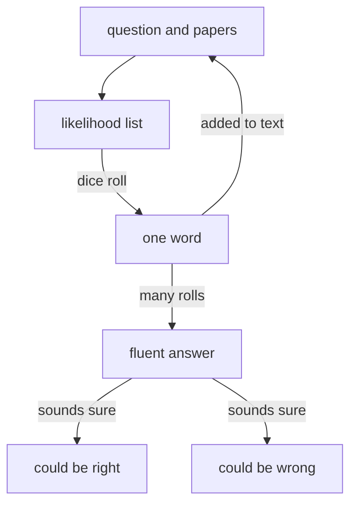

**See it yourself (2 minutes).** Ask the same design question, word for word, in two fresh chats, such as "Should retry logic live in the caller or the service?" Compare the answers and how sure each sounds.

**In SubhForge:** your cost rules already assume runs vary: "repeated semantically identical failures stop instead of burning budget" (Architecture §22).

**Chain so far:** remembers nothing → output varies

**Check yourself:** An agent writes "all tests pass" in a confident sentence. What does the confidence tell you?

*Tomorrow:* the builder only ever writes words on paper. So how does anything on the site get built?

*Source:* [Agentway Harness Books, book 1: Claude Code](https://github.com/subhadlearner/my-learning-with-claude/blob/main/HarnessEngineering/Resources/book1-claude-code-en.pdf), ch. 1 §1.5, p. 10: "External systems do not forgive bad execution just because model tone sounds confident."

### Day 3 · 6 Oct: How does a text function get any work done?

**Day 3: How does a text function get any work done?**

*Yesterday:* Nothing. Fluent wording comes from the same dice process whether the statement is true or not.

The builder never leaves the site office; he has only a pen. Yet by evening a wall is up. Who built it?

**Step 1. What can the model actually produce?** Only text (Day 1). Text cannot run a test or save a file; "run the tests" is just words on a page.
*He can write "lay bricks on the north wall", but writing it lays nothing.*

**Step 2. So how does anything happen?** An ordinary program reads the text the model wrote. When the text is a request in an agreed form, such as "run command: dotnet test", the program runs that command on your machine. These agreed actions are called "tools".
*A runner picks up his slip, walks out, and does exactly what it says.*

**Step 3. How does the model learn what happened?** It can't watch. So the program writes down the result ("12 passed, 1 failed: OrderTests") as text, adds it to the transcript, and calls the model again with all of it.
*The runner comes back with a note, and it goes on the pile of papers in front of him.*

**Step 4. When does it stop?** The program repeats this until the model's text says the job is finished. That is a claim too (Day 2), but it ends the loop.
*Slip, note, slip, note, until he writes "done" and the runner stops.*

**Now it's obvious.** An agent is the model called in a loop by a program: the program does every action and feeds each result back as text. The model never touches your files; the program does.

**Picture.**

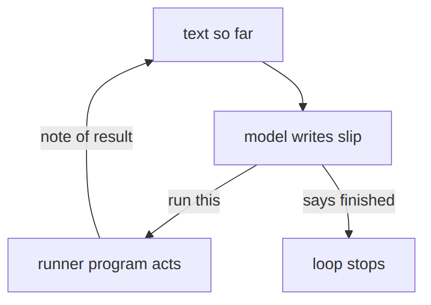

**See it yourself (2 minutes).** Open one finished task in Kilo and look at its step list. Each tool call is a slip; each result shown under it is the runner's note.

**In SubhForge:** your execution plane already separates the writer from the doers: "Execution combines: SubhForge lifecycle rules; specialized agents; deterministic utilities" (Architecture §4.3).

**Chain so far:** remembers nothing → output varies → works through a loop

**Check yourself:** When an agent "edits a file", who actually edits it?

*Tomorrow:* twenty slips in a row, and one misread measurement on slip 3. What happens to the other seventeen?

*Source:* [Google, "Agents" whitepaper](https://github.com/subhadlearner/my-learning-with-claude/blob/main/HarnessEngineering/Resources/22365_19_Agents_v8.pdf), p. 18: "A model outputs a Function and its arguments, but doesn't make a live API call."

### Day 4 · 7 Oct: Why do long tasks go wrong even with a good model?

**Day 4: Why do long tasks go wrong even with a good model?**

*Yesterday:* The program around the model edits it, following text the model wrote.

Today the builder sends twenty slips to put up one room. Almost every slip is right. Yet by evening the room is crooked. How?

**Step 1. Can one step be wrong?** Yes. Each word is a weighted roll (Day 2), so every step has a small chance of being off, however good the model.
*Even forty years of skill misreads a measurement now and then.*

**Step 2. What happens to an error on step 3?** In the loop (Day 3), every call reads the whole transcript, which now holds step 3's output. Step 4 builds on it as if true, then step 5. The error is carried forward, not averaged away.
*He misreads the wall height on slip 3; slips 4 to 20 set window and roof faithfully to the wrong height.*

**Step 3. What are the odds of a clean run?** Every step must be right. At 95% per step, twenty steps is 0.95 multiplied by itself twenty times: about 0.36. Roughly one clean run in three.
*Twenty good slips in a row is far rarer than one good slip.*

**Step 4. Does a better model fix this?** It raises the per-step number: at 99%, twenty steps gives about 82%. But the multiplying remains, and real tasks run longer: fifty steps at 99% is about 60%.
*A finer builder misreads less often, but nothing on his slips marks the misread one.*

**Step 5. What changes the odds?** Looking at the work from outside the loop after a step, before the next one builds on it. A caught error costs one step, not seventeen.
*Someone measures the wall after slip 3, before the window goes in.*

**Now it's obvious.** Small error rates multiply across steps, so long tasks fail often even with a good model. Only something outside the loop catching errors along the way stops one bad step spoiling the rest.

**Picture.**

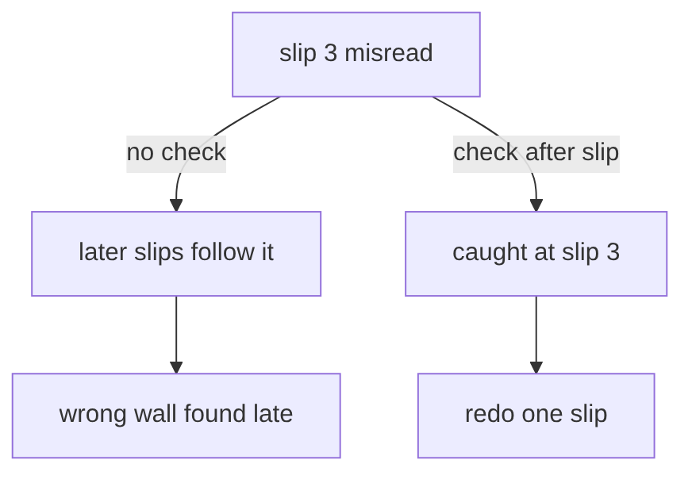

**See it yourself (2 minutes).** On a calculator, work out 0.9^10, 0.95^20 and 0.99^50. Then count roughly how many steps your last Kilo task took.

**In SubhForge:** your failure rules already expect errors mid-run: "Failures should be: detected → contained → diagnosable → recoverable" (Architecture §3.8).

**Chain so far:** remembers nothing → output varies → works through a loop → errors compound

**Check yourself:** Why does a smarter model not remove the need for checks on long tasks?

*Tomorrow:* he forgets everything overnight. So where must tomorrow's plan live?

*Source:* [learn-harness-engineering, Lecture 9](https://github.com/walkinglabs/learn-harness-engineering/blob/main/docs/en/lectures/lecture-09-why-agents-declare-victory-too-early/index.md): "every skipped verification compounds the information asymmetry."

### Day 5 · 8 Oct: If he forgets everything, where must the plan live?

**Day 5: If he forgets everything, where must the plan live?**

*Yesterday:* A smarter model raises each step's odds, but the odds still multiply; only a check outside the loop stops an error being carried forward.

Tonight the builder goes home; tomorrow he wakes remembering nothing. Yet the site must carry on from exactly where it stopped. Where does "where it stopped" live?

**Step 1. What must outlive today?** Three things: what was decided (the wall is 2.7 m high), what is done (north wall up), and what is next (the window). Lose any one and tomorrow repeats or contradicts today.
*The height he agreed, the walls he finished, the job planned for morning.*

**Step 2. Where could they be kept?** Only three places. In the model: ruled out, since its file of numbers never changes (Day 1). In the text of today's session, the transcript the loop builds (Day 3): it ends when the session ends. Or outside both, in a file.
*Not in his head, not on today's pile of slips, so in the site office.*

**Step 3. Is writing it down enough?** No. The model sees only the text put in front of it (Day 1), so a file nobody hands over is as good as lost. It must sit in a known place, and the harness (the program around the model) must read it back at the start.
*A diary left in a drawer helps no one; it is handed to him at the gate each morning.*

**Step 4. Isn't the chat history already such a record?** It looks like one, but nobody chose what it keeps. It holds every false start (Day 2), exists only because the talk happened, and gets cut when long.
*Yesterday's pile of slips, crossed-out ones included, is not a diary.*

**Now it's obvious.** Anything that must survive a session is written on purpose to a durable place outside the model, and read back on purpose at the start of the next one.

**Picture.**

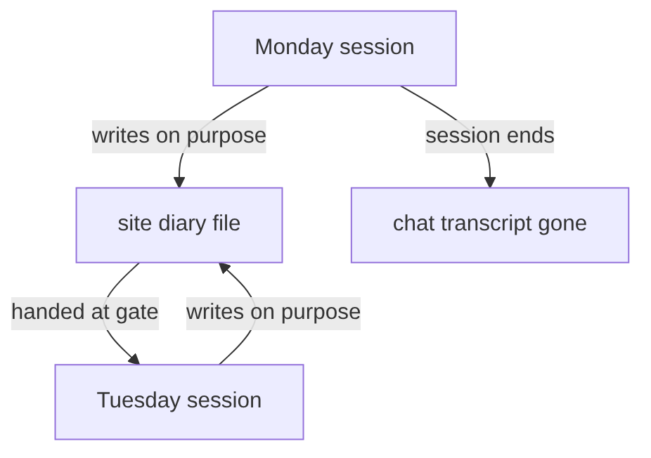

**See it yourself (2 minutes).** For your current project, ask: if every chat were deleted today, what would be lost?

**In SubhForge:** your recovery rule already says this: "Interrupted work must resume from durable authority, not model memory" (Architecture §3.8).

**Chain so far:** remembers nothing → output varies → works through a loop → errors compound → truth written outside

**Check yourself:** What separates durable state from a chat history?

*Tomorrow:* two sets of drawings sit in the site office, and only one was revised. Which does he build from?

*Source:* [OpenAI, "Harness engineering: leveraging Codex in an agent-first world"](https://github.com/subhadlearner/my-learning-with-claude/blob/main/HarnessEngineering/Resources/Harness%20engineering_%20leveraging%20Codex%20in%20an%20agent-first%20world%20_%20OpenAI.pdf), p. 6: "anything it can't access in-context while running effectively doesn't exist."

### Day 6 · 9 Oct: What happens when two documents disagree?

**Day 6: What happens when two documents disagree?**

*Yesterday:* Durable state is written on purpose, in a known place, and read back on purpose.

The site office keeps two sets of drawings, one on the wall, one in a drawer. The owner changes the window height; someone revises the wall set. Next morning the builder is handed the drawer set. What gets built?

**Step 1. How does a fact end up in two places?** Copying is cheap: a rule from the design notes gets pasted into a task description. Both copies start identical.
*A spare set for the drawer, matching the wall set the day it was made.*

**Step 2. What happens when the fact changes?** Someone updates the copy in front of them. The other copy is not visibly wrong, just old. Now they disagree, and nothing marks which is current.
*Wall set: 1.2 m. Drawer set: 1.0 m. Both look official.*

**Step 3. Which copy does the model use?** Whichever text is put in front of it (Day 1). It cannot see the other copy, so it cannot know a conflict exists.
*He builds from the set in his hands. He has never seen the wall.*

**Step 4. Wouldn't someone catch it?** A person might ask "which is right?" The model has no such moment. It carries on, and its report sounds as sure as ever (Day 2).
*He fits the window at 1.0 m and says "window done" with full assurance.*

**Step 5. So what removes the danger?** Not more care; sooner or later a copy gets missed. Remove the copy. The fact lives in one place; anything else says "see there".
*One set of drawings. The work order says "window per drawing 3", not "1.0 m".*

**Now it's obvious.** Each fact needs exactly one home; everything else points to it. Copies drift apart, and the model builds from whichever it is handed.

**Picture.**

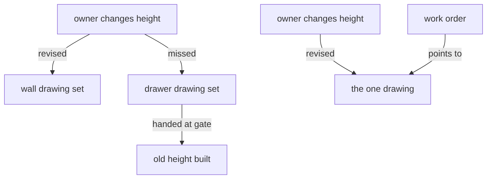

**See it yourself (2 minutes).** Find one fact written twice in a repo of yours, such as a version number. Do the copies still agree?

**In SubhForge:** your design folder rests on this: "Every decision has one authoritative home. Other documents reference it; they do not redefine it." (design/README.md).

**Chain so far:** remembers nothing → output varies → works through a loop → errors compound → truth written outside → one home per fact

**Check yourself:** Why is a duplicated fact more dangerous for an agent than for a team of people?

*Tomorrow:* the drawings change rarely, the job board hourly. Should they share one sheet?

*Source:* [OpenAI, "Harness engineering: leveraging Codex in an agent-first world"](https://github.com/subhadlearner/my-learning-with-claude/blob/main/HarnessEngineering/Resources/Harness%20engineering_%20leveraging%20Codex%20in%20an%20agent-first%20world%20_%20OpenAI.pdf), p. 4: "Agents can't tell what's still true."

### Day 7 · 10 Oct: Is "what we are building" the same kind of fact as "what is done"?

**Day 7: Is "what we are building" the same kind of fact as "what is done"?**

*Yesterday:* People notice when two copies disagree and ask; the model builds from the copy in front of it and carries on.

Every fact now has one home: one big sheet with the drawings, and today's jobs pencilled on top. By noon it is a smudge. Is one sheet the problem?

**Step 1. How often does each fact change?** "The kitchen faces east" holds for months, and changing it deserves the owner's review. "Plastering in progress" changes several times a day.
*Drawings are revised rarely and signed; today's jobs move hourly.*

**Step 2. What happens when both share one place?** The hourly edits bury the rare ones. A real design change hides among fifty "started" and "finished" marks.
*Rub out "plastering" for the tenth time and the window height beside it smudges too.*

**Step 3. So keep them apart?** Yes: one place for what we are building, changed with care; one for the state of the work, updated freely. Each fact still has one home (Day 6).
*The drawings on the wall; a job board beside them, cards moved all day.*

**Step 4. And "how far along are we?"** A third kind: not decided by anyone, but worked out by reading the other two. Keep it as an edited document and it becomes a second copy of facts that live elsewhere (Day 6). It drifts, and the model builds from whatever it is handed (Day 1).
*The foreman reads the board each evening and writes a summary. Next evening he does not edit it; he reads the board afresh.*

**Now it's obvious.** Slow-changing meaning and fast-changing work state live apart, and a view computed from them is never stored as truth: it is worked out again when needed.

**Picture.**

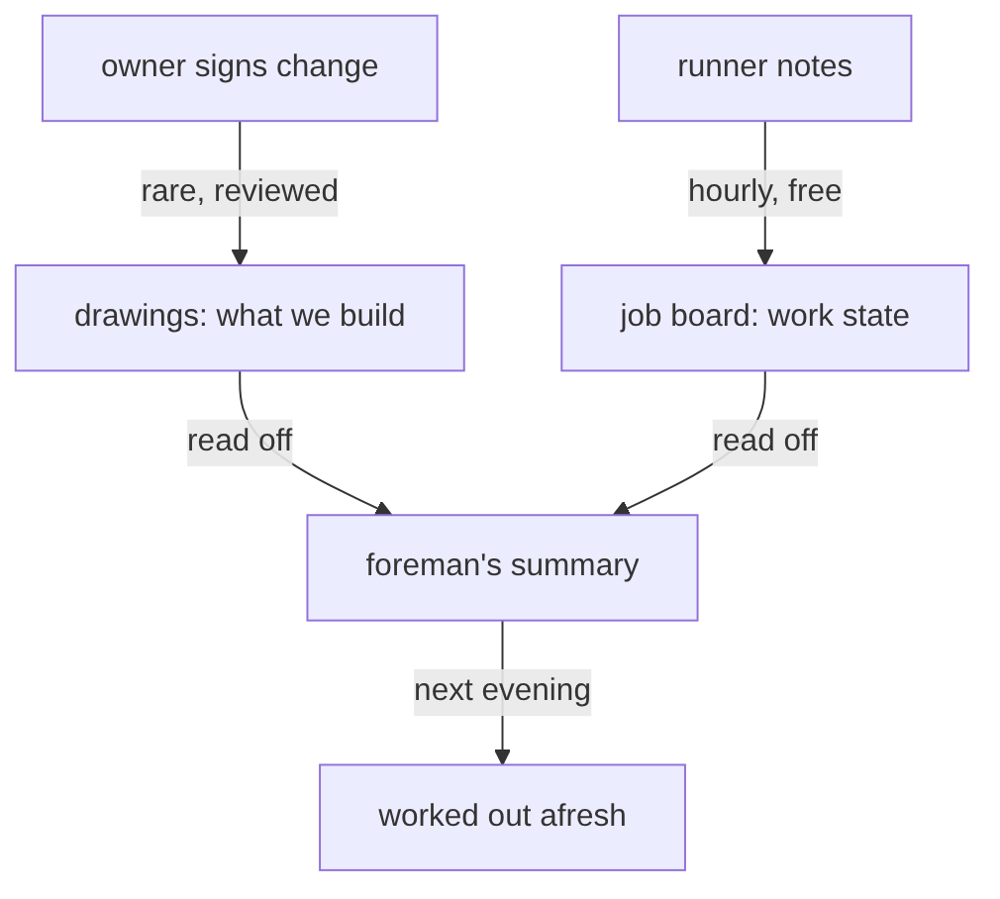

**See it yourself (2 minutes).** Find one status document in a project of yours. Could it be regenerated from the code and the issue tracker?

**In SubhForge:** your design splits all three: Product Truth in Git (Architecture §4.1), an Operational Work Graph (§4.2), and status views that "are read-only projections" (§4.3).

**Chain so far:** remembers nothing → output varies → works through a loop → errors compound → truth written outside → one home per fact → kinds of truth kept apart

**Check yourself:** Why must a status report never be edited by hand?

*Tomorrow:* the office holds drawings, a board and a diary. Why not hand him all of it?

*Source:* [OpenAI, "Harness engineering: leveraging Codex in an agent-first world"](https://github.com/subhadlearner/my-learning-with-claude/blob/main/HarnessEngineering/Resources/Harness%20engineering_%20leveraging%20Codex%20in%20an%20agent-first%20world%20_%20OpenAI.pdf), p. 5: the repository layout keeps `product-specs/`, `exec-plans/active/` and `generated/` in separate folders.

### Day 8 · 11 Oct: Why not hand him everything?

**Day 8: Why not hand him everything?**

*Yesterday:* A status report is computed from the real stores, so an edited copy becomes a second home for those facts and drifts.

The office holds drawings, a job board and a diary. Why not hand him the whole filing cabinet at the gate, just to be safe?

**Step 1. How much text can the model take in at once?** There is a hard limit, the context window, counted in tokens (word-pieces, about three-quarters of a word each). Every model's documentation states it; past it, text is cut off or the call fails.
*His desk holds only so many sheets.*

**Step 2. Below that limit, is more text harmless?** No. Each next word is worked out by weighing all the text in front of the model (Day 2). One vital line among thousands gets a smaller share, so quality falls well before the limit.
*Bury "no nails in the oak floor" on page 600 and he reads straight past it.*

**Step 3. Does the extra text cost anything else?** Yes. The loop calls the model on every turn (Day 3), and each call reads all of it again: you pay per token, every turn, and wait longer.
*Rereading the cabinet before every slip takes all morning.*

**Step 4. So who decides what goes in?** Not the model: it cannot ask for a page it does not know exists (Day 1). The truth lives outside (Day 5), so the program around it must choose what to bring in.
*The clerk picks today's three sheets and leaves the rest filed.*

**Now it's obvious.** What goes in front of the model is a budget: limited space, limited attention, real cost. Choosing what fills it is a design decision.

**Picture.**

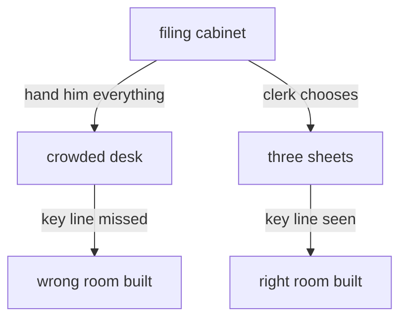

**See it yourself (2 minutes).** In one recent Kilo task, look at how much text it loaded before its first step.

**In SubhForge:** working context targets roughly 20–40k tokens with a 100k ceiling, to "stop rather than silently overflow" (§21.1), and says "Do not load broad project history by default" (§21.2).

**Chain so far:** remembers nothing → output varies → works through a loop → errors compound → truth written outside → one home per fact → kinds of truth kept apart → context is a budget

**Check yourself:** Why is "give it the whole repo to be safe" the wrong instinct?

*Tomorrow:* if the desk holds only a few sheets, how big should one job be?

*Source:* [OpenAI, "Harness engineering: leveraging Codex in an agent-first world"](https://github.com/subhadlearner/my-learning-with-claude/blob/main/HarnessEngineering/Resources/Harness%20engineering_%20leveraging%20Codex%20in%20an%20agent-first%20world%20_%20OpenAI.pdf), p. 4: "Context is a scarce resource. A giant instruction file crowds out the task, the code, and the relevant docs."

### Day 9 · 12 Oct: How big should one job be?

**Day 9: How big should one job be?**

*Yesterday:* More text thins the model's attention and raises the cost, so the lines that matter are more likely to be missed.

The owner wants a house, and the builder's desk holds only a few sheets (Day 8). Is "build the house" one job, or fifty?

**Step 1. What must fit on the desk for one job?** The job plus everything it needs: drawings, rules, progress so far. All of it must fit the context window (the text the model takes in at once, Day 8).
*"Build the house" needs every drawing at once; "fit out the downstairs bathroom" needs three sheets.*

**Step 2. Does a smaller job help in another way?** Yes. Errors carry forward (Day 4): at 95% right per step, 20 steps succeed about 36% of the time, 5 steps about 77%.
*Twenty slips for a whole floor; five for one bathroom.*

**Step 3. Is "small" enough?** No. Take "lay the bathroom pipes", testable only once the kitchen mains are in. Nobody can tell whether it is finished, so a hidden leak waits and the next job builds on it (Day 4).
*He reports the bathroom done; nobody can test its joints for a week.*

**Step 4. So what decides the size?** Two tests: everything it needs fits on the desk, and you can tell it is finished by checking that job alone. A written description of one such job, saying what to build and how to tell it is done, is a spec.
*The work order: "Downstairs bathroom: tiles, taps, drain. Done when water runs and drains with no leak."*

**Now it's obvious.** A good unit of work fits in one context and can be checked on its own. The work order that passes both tests is a spec.

**Picture.**

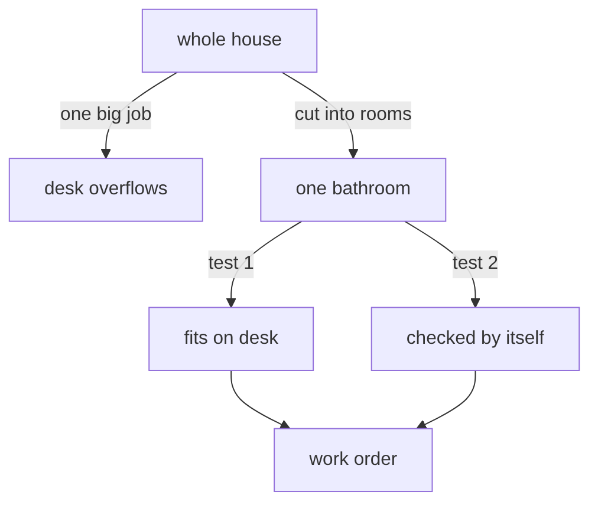

**See it yourself (2 minutes).** Take a recent agent task. Did everything it needed fit in one load? Could you tell it was done without checking any other task?

**In SubhForge:** your design sizes a Spec artifact at roughly 5–15k tokens (§21.1) and describes specs as "implementation-ready behavioral slices" (§3.6).

**Chain so far:** remembers nothing → output varies → works through a loop → errors compound → truth written outside → one home per fact → kinds of truth kept apart → context is a budget → work cut to fit

**Check yourself:** Name the two properties of a good unit of work for an agent.

*Tomorrow:* the bathroom has a test. When he says "done", what do you actually have?

*Source:* [learn-harness-engineering, Lecture 07: "Why agents overreach and under-finish"](https://github.com/walkinglabs/learn-harness-engineering/blob/main/docs/en/lectures/lecture-07-why-agents-overreach-and-under-finish/index.md): "Done is not 'code is written' — it's 'behavior verification passes.' In your feature list, every entry needs a verification command."

### Day 10 · 13 Oct: When he says "done", what do you have?

**Day 10: When he says "done", what do you have?**

*Yesterday:* It fits in one bounded context, and its completion can be checked on its own.

The bathroom work order says "done when water runs and drains with no leak" (Day 9). At five o'clock his slip arrives: "Bathroom finished, no leaks." What is in your hand?

**Step 1. Where did that sentence come from?** Like every sentence he writes: one likely word after another, picked by a weighted dice roll (Day 2). Nothing in that process looks at the pipes.
*The slip was written in the site office, not under the sink.*

**Step 2. Would a false "done" look any different?** No. A wrong answer is made the same way and reads just as smoothly (Day 2). Side by side, you cannot tell which bathroom leaks.
*The same steady hand, whether or not the joint drips.*

**Step 3. So what can tell them apart?** Only the work itself: run the tap and watch the drain, the test the work order names (Day 9).
*Someone has to walk into the bathroom.*

**Step 4. Can the builder go and check it himself?** His check is one more output of the same process, with the same blind spots. If he misread the drawing when fitting the pipe, he misreads it again when inspecting.
*The builder who fitted the wrong pipe will also pass the wrong pipe.*

**Step 5. Is "someone checked it" enough?** Not if it is only said. Tomorrow nobody remembers (Day 1), and "the inspector said fine" is another claim. The check must leave a record: what was tested, the result, by whom.
*The inspector's signed sheet: "Tap run five minutes. Drain clear. No drip."*

**Now it's obvious.** His "done" is a claim. It becomes a fact only when something other than him checks the work itself and leaves a record.

**Picture.**

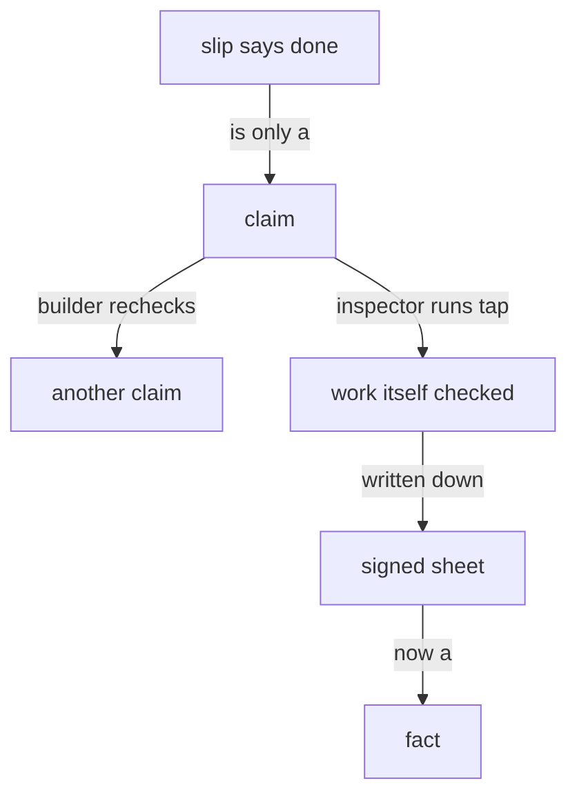

**See it yourself (2 minutes).** Recall the last time an agent said something was finished. What did you actually check, and is there a record?

**In SubhForge:** your contracts keep "verification facts are separate from judgement" and treat "verification reports are immutable evidence" (Contracts §23.1).

**Chain so far:** remembers nothing → output varies → works through a loop → errors compound → truth written outside → one home per fact → kinds of truth kept apart → context is a budget → work cut to fit → claims need evidence

**Check yourself:** Why can the agent that wrote the code not certify it?

*Tomorrow:* if not the builder, who should the inspector be?

*Source:* [AI Harness Engineering: A Runtime Substrate for Foundation-Model Software Agents, p. 5](https://github.com/subhadlearner/my-learning-with-claude/blob/main/HarnessEngineering/Resources/AI%20Harness%20Engineering-A%20Runtime%20Substrate%20for%20Foundation-Model%20Software%20Agents.pdf): "Task completion is bound to evidence ... rather than to a natural-language assertion."

### Day 11 · 14 Oct: Who should the inspector be?

**Day 11: Who should the inspector be?**

*Yesterday:* Its certificate is another output of the same process, with the same blind spots; it adds confidence, not evidence.

The builder cannot inspect his own bathroom (Day 10). At the gate wait a second master builder and a toolbox with a tape measure. The sheet asks: "Does the drain clear in a minute?" and "Is the layout sensible?" Who answers which?

**Step 1. Are those two questions the same kind?** No. The first has one right answer, found by fixed steps: run the tap, time the drain. The second has no recipe; it needs judgement.
*One line is for the stopwatch, the other for the architect's eye.*

**Step 2. What does ordinary code do with the first kind?** A test or a linter (a program that checks code against fixed rules) runs the same steps every time: same input, same answer.
*The tape measure reads 2.38 m every time.*

**Step 3. What if a model answered the first kind instead?** Its answer is another dice roll (Day 2): asked twice, it can say "pass" then "fail". And it adds one more step that can be wrong (Day 4).
*Asking the second builder to eyeball the wall while the tape measure sits in the box.*

**Step 4. Then what are the model and the human for?** The second kind: does this design fit what the owner meant? Code has nothing to compute there, so judgement is the only tool, recorded as an opinion with reasons, not as proof.
*The architect writes: "Basin too close to the door; move it."*

**Now it's obvious.** Whatever software can prove is checked by ordinary code, because code gives the same answer every time. The model and the human are kept for the questions that need judgement.

**Picture.**

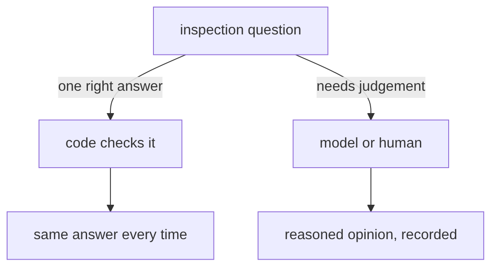

**See it yourself (2 minutes).** Mark three checks in your workflow "computable" or "judgement". Is a model answering a computable one?

**In SubhForge:** your design says "Use deterministic code for things software can prove reliably" (§3.3), and tags each invariant DETERMINISTIC, SEMANTIC or MIXED (§5.3).

**Chain so far:** remembers nothing → output varies → works through a loop → errors compound → truth written outside → one home per fact → kinds of truth kept apart → context is a budget → work cut to fit → claims need evidence → code checks what code can prove

**Check yourself:** What is the test for whether a check belongs in code?

*Tomorrow:* Tuesday's sheet is signed; on Wednesday the wall changes. Is the sheet still good?

*Source:* [Harness engineering: leveraging Codex in an agent-first world (OpenAI), p. 7](https://github.com/subhadlearner/my-learning-with-claude/blob/main/HarnessEngineering/Resources/Harness%20engineering_%20leveraging%20Codex%20in%20an%20agent-first%20world%20_%20OpenAI.pdf): "These constraints are enforced mechanically via custom linters ... and structural tests."

### Day 12 · 15 Oct: Is yesterday's inspection still good today?

**Day 12: Is yesterday's inspection still good today?**

*Yesterday:* If the right answer can be computed without judgement, it belongs in code.

On Tuesday the inspector signs a sheet for the kitchen wall: passed (Day 10). On Wednesday the owner moves a doorway, and the builder cuts the wall to suit. On Thursday someone waves Tuesday's sheet. What is it worth?

**Step 1. What does a sheet actually say?** It reports what was found on one thing at one moment: "this wall, built to drawing revision 3, checked Tuesday, passed." A revision is a numbered version of a drawing; in code, a commit ID names an exact version the same way.
*The inspector writes the date and the drawing revision at the top.*

**Step 2. After Wednesday's cut, is the sheet false?** No. It is still true, but about Tuesday's wall, and that wall no longer exists.
*An accurate sheet about a wall you can no longer stand in front of.*

**Step 3. So what do you know about today's wall?** Only what the builder says: "small cut, nothing else touched." That is a claim (Day 10). The cut may have hit a pipe, and no sheet has seen the cut.
*Nobody has run the tape measure over the new opening.*

**Step 4. How do you stop an old sheet passing for a new one?** Every sheet must name the exact version it checked, and counts only while that version is what stands. When the version differs, the sheet stops counting and the work is checked again, by code wherever code can prove it (Day 11).
*No revision number matching the wall, no sign-off.*

**Now it's obvious.** Evidence is about one exact version of the work. When the work changes, the evidence stops applying, and what remains is a claim until it is checked again.

**Picture.**

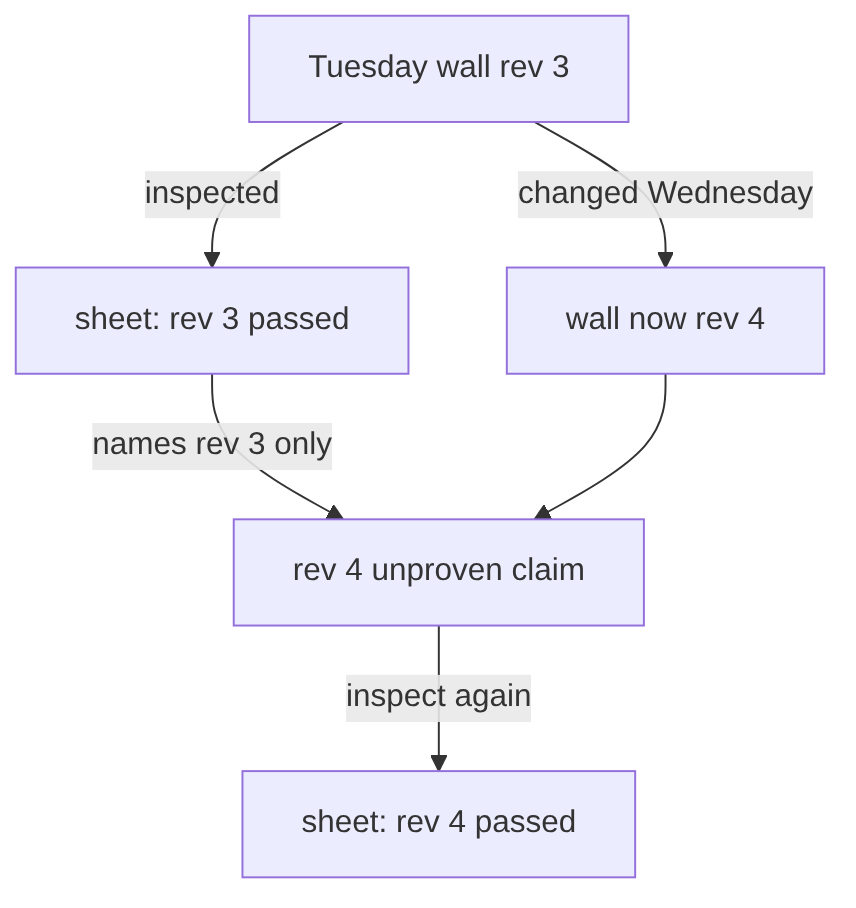

**See it yourself (2 minutes).** Recall a time you trusted a green test run after more code had changed. Which commit had the tests actually seen?

**In SubhForge:** your contracts say "evidence freshness must match the implementation identity it claims to prove" (Contracts §23.1).

**Chain so far:** remembers nothing → output varies → works through a loop → errors compound → truth written outside → one home per fact → kinds of truth kept apart → context is a budget → work cut to fit → claims need evidence → code checks what code can prove → evidence expires

**Check yourself:** Tests passed yesterday and the code changed today. What exactly do you know?

*Tomorrow:* the next room's materials are on site and the builder could start. Does that mean he should?

*Source:* [Agentway Harness Books, book 1: Claude Code, §7.7, p. 63](https://github.com/subhadlearner/my-learning-with-claude/blob/main/HarnessEngineering/Resources/book1-claude-code-en.pdf): "before users act on outputs, someone must return to current reality and revalidate."

### Day 13 · 16 Oct: Who decides?

**Day 13: Who decides?**

*Yesterday:* Only that yesterday's version passed; about today's code you have a claim until it is checked again.

The kitchen passed inspection. Bathroom tiles are on site, scaffolding up. He could start tiling now and pick the colour himself. Should he?

**Step 1. What does he know about what the owner wants?** Only what is on the papers handed to him at the gate (Day 1). The owner wants more than any drawing says: colours they hate, delay they will accept, what "finished" means.
*The drawing says "tiled wall". It does not say "never grey".*

**Step 2. When he fills that gap himself, what has he produced?** A guess about the owner's wishes. His report of it is a claim (Day 10), as sure-sounding as a correct one (Day 2).
*He tiles in grey and reports "bathroom done" in the same calm voice.*

**Step 3. Who lives with the result if the guess is wrong?** Not him: tomorrow he remembers nothing and loses nothing. The owner lives in the house and pays to redo it. So what is wanted, what risk is acceptable and whether work is accepted are choices for the person who bears the result.
*The owner signs off, because the owner has to live there.*

**Step 4. The tiles are here and the kitchen passed. Isn't that a "go"?** That is readiness: everything this job depends on is done, a fact code can work out (Day 11). Starting is a choice, and Step 3 says whose.
*Scaffolding standing ready is not an instruction to build.*

**Now it's obvious.** Decisions about meaning, risk and acceptance stay with the person who bears the consequences. "This is ready" or "this is possible" is never "this is permitted".

**Picture.**

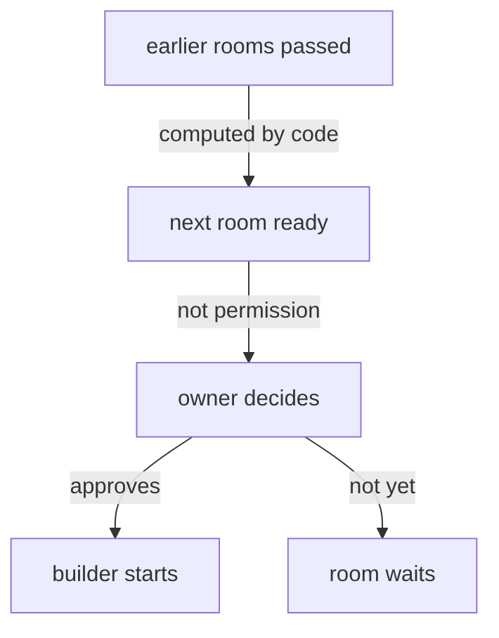

**See it yourself (2 minutes).** Recall a time an agent did something because it could, not because you asked.

**In SubhForge:** when it cannot classify an ambiguity "it does not guess" (§3.4), and a dependency is "never permission to act" (§3.5).

**Chain so far:** remembers nothing → output varies → works through a loop → errors compound → truth written outside → one home per fact → kinds of truth kept apart → context is a budget → work cut to fit → claims need evidence → code checks what code can prove → evidence expires → the human decides

**Check yourself:** What is the difference between work being ready and work being authorised?

*Tomorrow:* the owner changes a drawing after three rooms are finished. Which of them must be redone?

*Source:* [Agentway Harness Books, book 1: Claude Code, Chapter 4, p. 32](https://github.com/subhadlearner/my-learning-with-claude/blob/main/HarnessEngineering/Resources/book1-claude-code-en.pdf): "Intent understanding is not authorization… Systems must split 'can do' from 'may do.'"

### Day 14 · 17 Oct: What breaks when the plan changes?

**Day 14: What breaks when the plan changes?**

*Yesterday:* Ready is a fact about dependencies that code can work out; authorised is a decision that belongs to the person.

Kitchen and bathroom are finished and inspected; the bathroom, built second, runs off the kitchen's plumbing. Now the owner moves the kitchen window. What must be redone?

**Step 1. Where does the window's position live?** In one drawing (Day 6). Each sheet names the revision it checked (Day 12).
*The kitchen sheet says "revision A". The drawing is now revision B.*

**Step 2. Which sheets stop counting?** Only those that checked something the change touched. The window wall is different now; its sheet describes a wall that no longer exists.
*Kitchen: sheet void.*

**Step 3. The bathroom came later. Is it affected too?** Later is not the same as dependent. Ask: did it use what moved? It used the plumbing, which did not move. A room the change does not reach passes nothing on, so tracing stops there.
*He follows what the window touched, not the order of building.*

**Step 4. Why not redo everything after it, to be safe?** Each redo costs money, adds steps that can go wrong (Day 4), and discards sheets still true.
*Tearing out the good bathroom is waste; keeping the old wall is a hidden defect.*

**Step 5. Who says "go" on the redo?** The list of affected rooms is a finding; tearing out is a costly choice (Day 13).
*The change order lists the rooms; the owner signs before anything is torn out.*

**Now it's obvious.** When the truth changes, trace exactly which finished work rested on what changed, void only that evidence, and stop where the change stops mattering. Finding that set, approving, then redoing: that is reconciliation.

**Picture.**

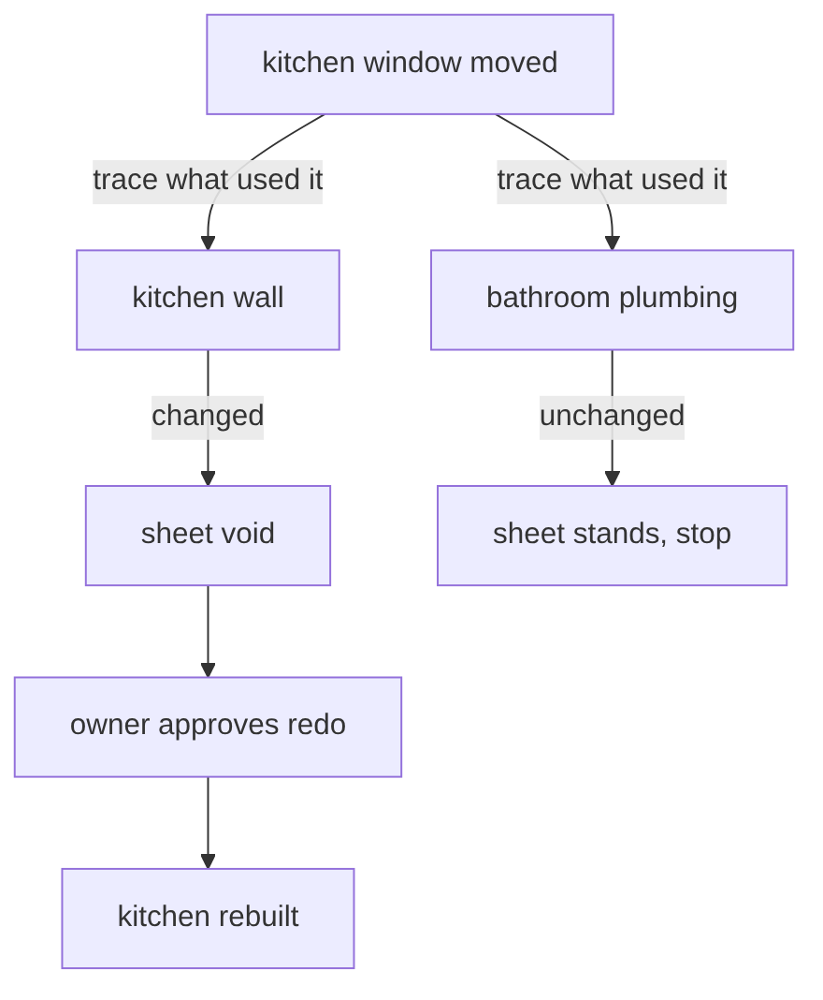

**See it yourself (2 minutes).** Trace what would need redoing if one of your requirements changed.

**In SubhForge:** reconciliation runs "analyse → human approve → apply", and "propagation stops at the first unaffected branch" (Contracts §16).

**Chain so far:** remembers nothing → output varies → works through a loop → errors compound → truth written outside → one home per fact → kinds of truth kept apart → context is a budget → work cut to fit → claims need evidence → code checks what code can prove → evidence expires → the human decides → change is reconciled

**Check yourself:** Why not simply mark everything downstream as affected?

*Tomorrow:* he is called away halfway through the new wall. What state is the site in tomorrow?

*Source:* [OpenAI, Harness engineering: leveraging Codex in an agent-first world, p. 5](https://github.com/subhadlearner/my-learning-with-claude/blob/main/HarnessEngineering/Resources/Harness%20engineering_%20leveraging%20Codex%20in%20an%20agent-first%20world%20_%20OpenAI.pdf): an agent "scans for stale or obsolete documentation that does not reflect the real code behavior."

### Day 15 · 18 Oct: What if he is interrupted halfway?

**Day 15: What if he is interrupted halfway?**

*Yesterday:* Marking everything downstream throws away evidence that is still valid and creates work that has no cause.

The kitchen wall's work order has three lines: brick up the old window, paint the wall, mark it done on the job board. He finishes two and is called away. Tomorrow he remembers nothing. What should he do?

**Step 1. How often does work stop partway?** Often. The loop is a program (Day 3); programs crash, hit a spending limit, or stop when a laptop closes. Stopping between any two actions is normal.
*He can be called away between any two slips.*

**Step 2. What does a three-line job look like after two lines?** The wall is painted; the job board still says "in progress". The outside truth is half-changed.
*Fresh paint on the wall; "in progress" on the board.*

**Step 3. Can the next session tell which lines ran?** No. It remembers nothing (Day 1), and the board says "not done". The only sensible move is to run the work order again from the top.
*He reads "rebuild the kitchen wall" and starts at line one.*

**Step 4. What happens when a line runs twice?** "Paint this wall white" run twice still leaves one white wall. "Add one more coat" run twice leaves an extra coat each time. The first is safe to repeat; the second is not.
*Same builder, same skill: one instruction survives a restart, the other does not.*

**Now it's obvious.** Any operation can be cut off and rerun by someone who cannot know where it stopped. So every change to the outside truth must be built so that doing it twice leaves the same result as doing it once.

**Picture.**

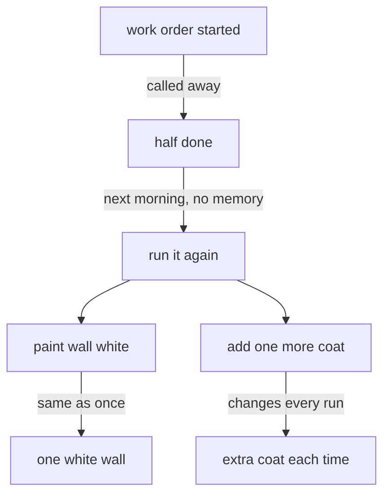

**See it yourself (2 minutes).** Find one script of yours that would do damage if run twice.

**In SubhForge:** reconciliation APPLY operations are idempotent, meaning safe to repeat (Contracts §16.3) and "never emit a success token first" (Contracts §2.4).

**Chain so far:** remembers nothing → output varies → works through a loop → errors compound → truth written outside → one home per fact → kinds of truth kept apart → context is a budget → work cut to fit → claims need evidence → code checks what code can prove → evidence expires → the human decides → change is reconciled → safe to repeat

**Check yourself:** In one sentence, what does "safe to repeat" mean?

*Tomorrow:* something still went wrong on the rerun. He remembers nothing; how does anyone find out what happened?

*Source:* [learn-harness-engineering, Lecture 12: Why every session must leave a clean state](https://github.com/walkinglabs/learn-harness-engineering/blob/main/docs/en/lectures/lecture-12-why-every-session-must-leave-a-clean-state/index.md): cleanup must "produce the same result regardless of how many times they run".

### Day 16 · 19 Oct: How do you find out what happened?

**Day 16: How do you find out what happened?**

*Yesterday:* Running an operation twice leaves the world exactly as running it once would.

This morning's rerun of the kitchen wall came out two shades of white. The owner asks what happened, and in what order. The builder remembers nothing. Who can answer?

**Step 1. What do you need to know after a failure?** What was done, to which item, in what order, and where it stopped. Without the order you cannot tell cause from effect.
*Was the wall painted yesterday, today, or both?*

**Step 2. Can the builder tell you?** No. He remembers nothing (Day 1). Ask anyway and he answers fluently, but the answer is made fresh by the dice (Day 2): a claim, not a record (Day 10).
*You get a confident story he has just made up.*

**Step 3. Who saw every action happen?** The program running the loop (Day 3): every instruction passes through it. So it can write each one down as it happens: what, to which item, the state before and after, which checks ran.
*Every slip passes through the site office, which notes it in the site log.*

**Step 4. Yesterday's run and today's rerun share one log. How do you follow one problem?** Tag every entry with its work order number. Read that number's entries in order, back to the first step that went wrong.
*The log shows the kitchen wall painted twice, today from a fresh tin.*

**Now it's obvious.** The model cannot tell you what it did, and anything it says is only a claim. So the harness, which sees every action pass through it, records each one as it happens, tagged so a failure can be followed back to where it began.

**Picture.**

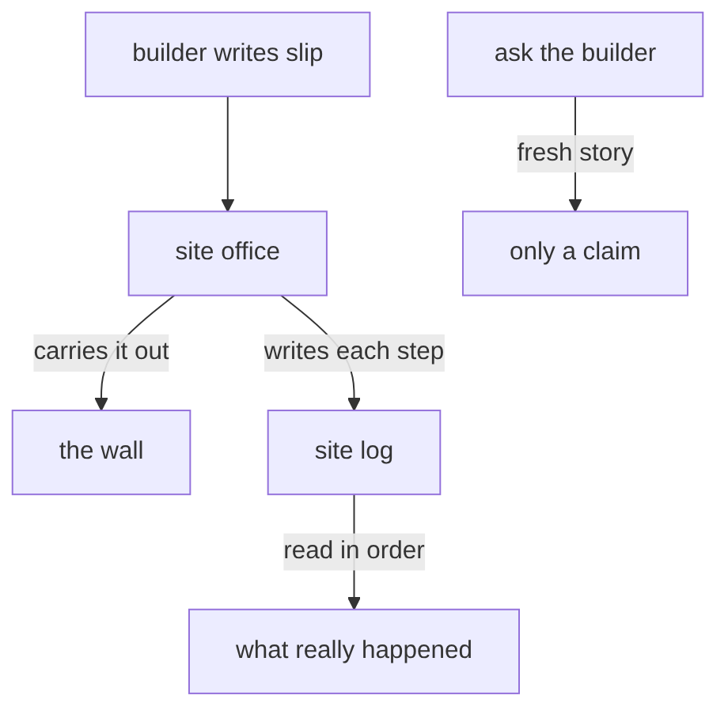

**See it yourself (2 minutes).** After your next agent failure, try to rebuild the order of events from its logs alone, without asking the agent.

**In SubhForge:** "Kilo owns harness/runtime telemetry. SubhForge owns lifecycle observability." (§23A)

**Chain so far:** remembers nothing → output varies → works through a loop → errors compound → truth written outside → one home per fact → kinds of truth kept apart → context is a budget → work cut to fit → claims need evidence → code checks what code can prove → evidence expires → the human decides → change is reconciled → safe to repeat → a trace is kept

**Check yourself:** Why not ask the agent what went wrong?

*Tomorrow:* sixteen links so far. Could the whole site be rebuilt from just the builder's two traits?

*Source:* [Zhong & Zhu, AI Harness Engineering: A Runtime Substrate for Foundation-Model Software Agents, p. 5](https://github.com/subhadlearner/my-learning-with-claude/blob/main/HarnessEngineering/Resources/AI%20Harness%20Engineering-A%20Runtime%20Substrate%20for%20Foundation-Model%20Software%20Agents.pdf): "The harness records how the agent selects context, invokes tools, attempts verification, recovers from failure, and incurs intervention."

### Day 17 · 20 Oct: Can you rebuild the whole design from two facts?

**Day 17: Can you rebuild the whole design from two facts?**

*Yesterday:* He has no memory of what he did, and anything he says about it is a claim, not a record.

Overnight the site is cleared. You keep only the builder's two traits: he remembers nothing, and he sometimes reports work finished when it is not. Can you rebuild everything that stood there, and nothing else?

**Step 1. What follows from "remembers nothing"?** The plan cannot live in him, so it is written outside (Day 5). Copies drift, so each fact gets one home (Day 6), and kinds of fact are kept apart (Day 7). He can take in only so much (Day 8), so jobs are cut to fit (Day 9).
*Back come the diary, the drawings, the job board, the one-room work orders.*

**Step 2. What follows from "sometimes says done wrongly"?** His "done" is a claim (Day 10). What can be measured is measured by tools (Day 11). Each sheet names the version it checked (Day 12). He bears no consequence, so the owner decides (Day 13).
*Back come the inspector, the tape measure, the dated sheet, the owner's signature.*

**Step 3. What follows when both meet a moving world?** Drawings change, so finished work is reconciled (Day 14). Interrupted, he cannot recall where he stopped, so jobs are safe to repeat (Day 15) and the office logs every slip (Day 16).
*Back come the change order, the repeatable instructions, the site log.*

**Step 4. So what lives in the builder himself?** Only his skill. Every paper and record sits in the office, so another builder could start tomorrow.
*The site belongs to the office, not to him.*

**Step 5. What if something on the old site traces to neither trait?** Say, every slip signed twice. It guards against nothing he lacks.
*Point at anything on site and ask: which trait put this here?*

**Now it's obvious.** Every part of a harness exists because the model remembers nothing or because its output varies. A rule that traces to neither is ceremony.

**Picture.**

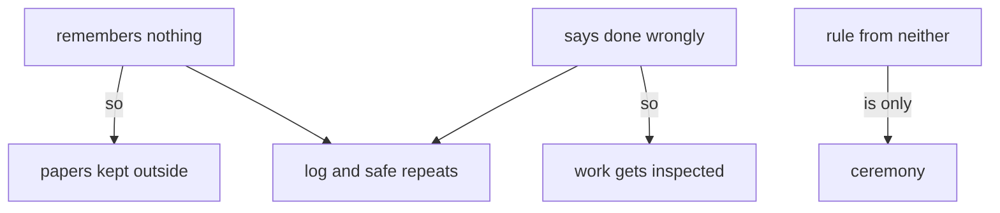

**See it yourself (2 minutes).** Pick one rule in your design and trace it back to one of the two traits.

**In SubhForge:** §3.1 keeps only what "materially help[s] Subhadeep design, build, verify, reconcile or resume his own projects", the same earn-your-place test.

**Chain so far:** remembers nothing → output varies → works through a loop → errors compound → truth written outside → one home per fact → kinds of truth kept apart → context is a budget → work cut to fit → claims need evidence → code checks what code can prove → evidence expires → the human decides → change is reconciled → safe to repeat → a trace is kept → one argument

**Check yourself:** Pick any rule in your design: which of the two facts does it exist because of?

*Tomorrow:* the wrap-up. Reading the chain is easy; can you use it to work out answers you were never told?

*Source:* [Zhong & Zhu, AI Harness Engineering: A Runtime Substrate for Foundation-Model Software Agents, p. 13](https://github.com/subhadlearner/my-learning-with-claude/blob/main/HarnessEngineering/Resources/AI%20Harness%20Engineering-A%20Runtime%20Substrate%20for%20Foundation-Model%20Software%20Agents.pdf): repositories assume a reader who can "remember testing practices"; "None of these assumptions hold for a foundation-model agent."

### Block 1 wrap-up · 21 Oct

**Block 1 wrap-up: Can you use the chain to work out what you were never told?**

*Yesterday:* Every necessary rule traces to "remembers nothing", to "output varies", or both. A rule that traces to neither is a candidate for removal.

**The chain**
1. Remembers nothing: only skill plus the papers in hand.
2. Output varies: a dice roll; confidence proves nothing.
3. Works through a loop: he writes slips, the runner acts.
4. Errors compound: small odds multiply over many slips.
5. Truth written outside: the diary, written and read back on purpose.
6. One home per fact: two drawings drift apart.
7. Kinds of truth kept apart: drawings, job board, summary.
8. Context is a budget: three sheets, not the cabinet.
9. Work cut to fit: one room, inspectable alone.
10. Claims need evidence: "done" is a claim until inspected.
11. Code checks what code can prove: tape measure first.
12. Evidence expires: the sheet names the drawing revision.
13. The human decides: ready is not permitted.
14. Change is reconciled: stop where it stops mattering.
15. Safe to repeat: "paint it white", not "add a coat".
16. A trace is kept: the office keeps the log.
17. One argument: every link comes from the two traits.

**Work these out**
1. A new builder starts tomorrow. Which papers must already exist for him to carry on?
2. The inspector is the same builder, asked next morning. Which two links make his sign-off worthless?
3. The foreman's summary and the job board disagree. Which do you correct, and which link says so?
4. A crash hits halfway through a change order. Which three links decide what happens next?
5. Someone proposes double-signing every slip. Which trait does it guard against? If neither, what is it?

Write in your notes what should change in length, depth or pace before Block 2.

### Review · 22 Oct: The Friday "all tests pass"

**Review: The Friday "all tests pass"**

**The story.** Friday evening a coding agent writes: "Fixed the login bug. All 42 tests pass." You merge it and go home. On Monday, login is broken. The run's record shows the test command timed out and never printed a result. The sentence was written anyway.

On site: the builder tells the owner, "Room three is finished and checked." Nobody from the office went into room three.

**Which link explains it?** The agent was not lying, and a smarter model would not have saved you. Which link in the chain says what you were holding on Friday, and what would have turned it into something you could merge on?

**Answer.** Day 10, claims need evidence. "All tests pass" is text from the same dice roll as any other sentence (Day 2), so a true "done" and a false one read the same. It becomes a fact only when something other than the builder looks at the work and leaves a record: here, the test output itself. Day 11 adds who should look: the test runner, which is ordinary code, not the model.

**Picture.**

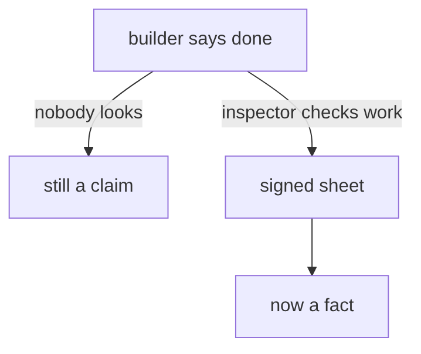

*Source:* [Barbaste et al., Harness Engineering: Anatomy, Architecture, and Evolution of Coding Agents, p. 24](https://github.com/subhadlearner/my-learning-with-claude/blob/main/HarnessEngineering/Resources/Harness%20Engineering%20Anatomy%20Architecture%20%20and%20Evolution%20of%20Coding%20Agents.pdf): Claude Code's prompt says "Never claim 'all tests pass' when output shows failures", but "prompt text is a behavioral wish, not a mechanism."

### Review · 23 Oct: The Friday migration that went backwards

**Review: The Friday migration that went backwards**

**The story.** On Thursday, over a long chat, you and the agent agree to move from SQLite to Postgres. It converts four modules. On Friday you open a new session and type "continue the migration". It reconverts two finished modules and writes a new one against SQLite, explaining its choices confidently.

On site: the builder spent Thursday agreeing a change with the owner, standing by the wall. Friday morning he arrives with no memory of it, and nothing about it is in the papers handed to him at the gate.

**Which link explains it?** The model is the same one that did good work on Thursday. Which link in the chain says where Thursday's decision should have been, and what that requires?

**Answer.** Day 5, truth written outside. Day 1 explains why the decision was lost: the model keeps nothing between sessions. Day 5 says what to do about it: write the decision to a durable place on purpose, and hand it back on purpose at the start of the next session. A chat history does neither.

**Picture.**

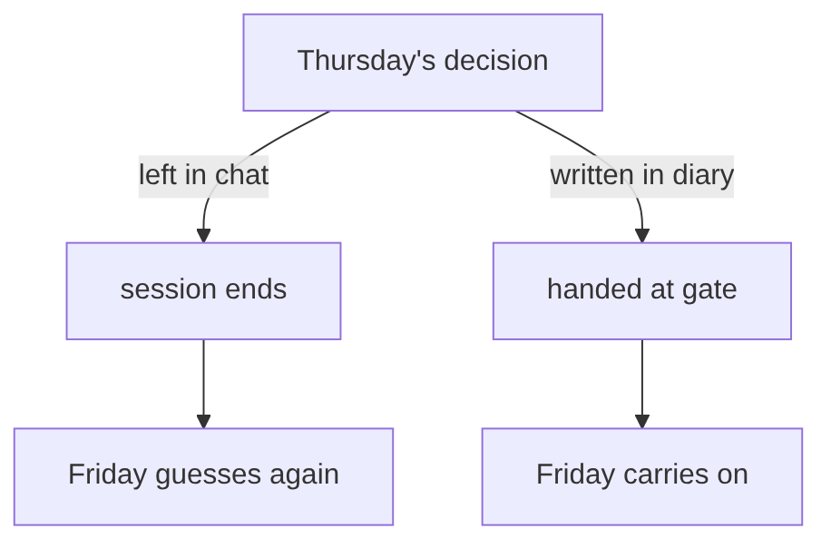

*Source:* [OpenAI, Harness engineering: leveraging Codex in an agent-first world, p. 6](https://github.com/subhadlearner/my-learning-with-claude/blob/main/HarnessEngineering/Resources/Harness%20engineering_%20leveraging%20Codex%20in%20an%20agent-first%20world%20_%20OpenAI.pdf): "Knowledge that lives in Google Docs, chat threads, or people's heads are not accessible to the system."

### Review · 24 Oct: The test style that went backwards

**Review: The test style that went backwards**

**The story.** Last month your team moved from unittest to pytest and updated AGENTS.md. The older docs/testing.md still shows unittest examples. You ask an agent to add tests for the payments module and link it the testing guide. It writes unittest classes and notes, confidently, that it "followed the project's testing guide."

On site: two sets of drawings, one revised. The builder is handed the old set at the gate and builds from it, sure he is right.

**Which link explains it?** A person who saw both files would stop and ask which is current. Which link says why the agent did not, and what would have prevented it?

**Answer.** Day 6, one home per fact. The model sees only the text it is handed (Day 1), so it cannot know the other file exists, and it carries on sounding sure (Day 2). The fix is not a smarter model but one home for the rule: the testing guide points to AGENTS.md instead of repeating it.

**Picture.**

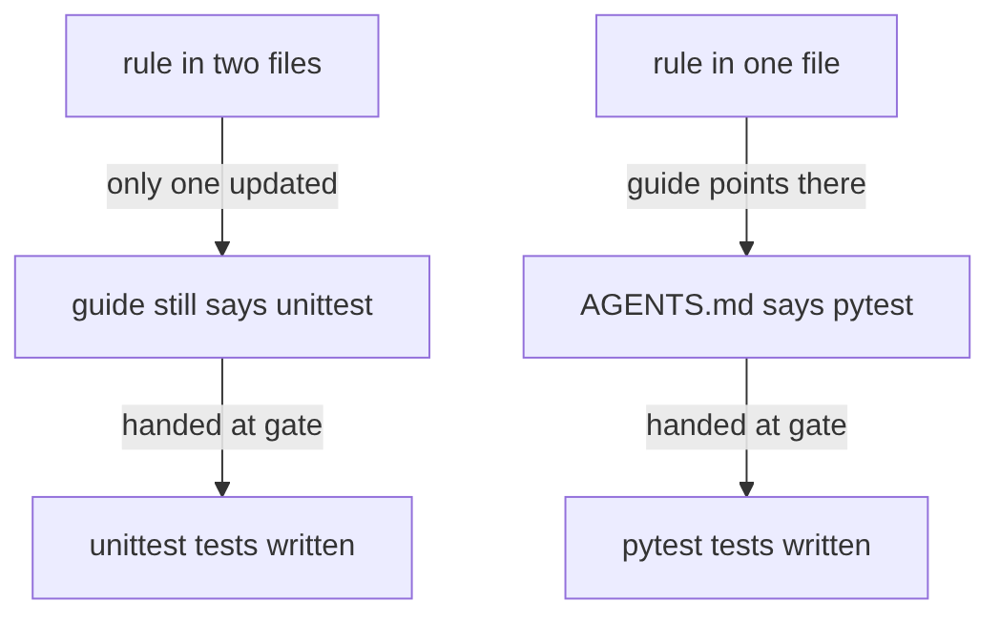

*Source:* [OpenAI, Harness engineering: leveraging Codex in an agent-first world, p. 4](https://github.com/subhadlearner/my-learning-with-claude/blob/main/HarnessEngineering/Resources/Harness%20engineering_%20leveraging%20Codex%20in%20an%20agent-first%20world%20_%20OpenAI.pdf): a monolithic manual "turns into a graveyard of stale rules. Agents can't tell what's still true."

### Review · 25 Oct: The twenty-step refactor that was wrong from step three

**Review: The twenty-step refactor that was wrong from step three**

**The story.** You ask an agent to switch a service's timeouts from seconds to milliseconds, in one long run with no tests until the end. Early on it misreads the config loader and treats the old values as milliseconds already. Every later edit, across eighteen files, is made to agree with that loader. At the end, nineteen tests fail, and fixing the last file fixes nothing.

On site: twenty slips in a row. One misread measurement on slip 3, and seventeen more are built faithfully on it.

**Which link explains it?** Each edit, read alone, looks careful and consistent. Which link says why the whole job went wrong, and why a better model would only make it rarer, not fix it?

**Answer.** Day 4, errors compound. Each step builds on the last one's output (Day 3), so an early error is carried forward, not averaged away. At 95% right per step, twenty steps succeed about 36% of the time. A better model raises the 95%; only a check outside the loop, after each small step, stops slip 3 reaching slip 20.

**Picture.**

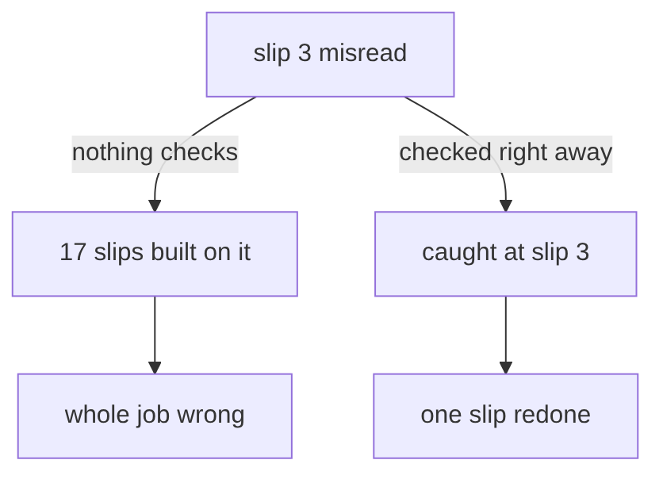

*Source:* [Barbaste et al., Harness Engineering: Anatomy, Architecture, and Evolution of Coding Agents, p. 39](https://github.com/subhadlearner/my-learning-with-claude/blob/main/HarnessEngineering/Resources/Harness%20Engineering%20Anatomy%20Architecture%20%20and%20Evolution%20of%20Coding%20Agents.pdf): Aider's reflection loop with three-stage linting provides safety "by catching errors before they propagate."

## Block 2: The loop in depth (26 Oct–1 Nov)

This block opens up the loop from Day 3: what it carries from turn to turn, how it stops, and what it must leave behind when it does. The recap is on 1 November.

18. What exactly is handed to him each time he is asked "what next?"
19. How does the loop know when to stop?
20. What if he never stops writing slips?
21. How do you notice he is going round in circles before the allowance runs out?
22. What should a failed check do to the loop?
23. What must be on the clipboard when work stops?

### Day 18 · 26 Oct: What exactly is handed to him each time he is asked "what next?"

**Day 18: What exactly is handed to him each time he is asked "what next?"**

*Yesterday:* Day 4, errors compound: each slip builds on the last, so only a check after each small step stops slip 3's mistake reaching slip 20.

On turn 3 the runner's note says "the port in config.json is 5432." On turn 9 the builder writes a slip using 5432. He remembers nothing between calls. So where did turn 9 get the number?

**Step 1. What does the program actually send the model?** A list of messages, each labelled with who wrote it: the standing instructions, your request, the model's replies (slips), the program's results (notes). This list is the transcript.
*On his desk lies a clipboard: every paper so far, in order, each marked with whose hand wrote it.*

**Step 2. What is one turn?** One call. The whole list goes in; one new message comes out. If it is a slip, the program runs it and appends the result as a note. So the list grows every turn.
*Asked "what next?", he is handed the whole clipboard, writes one slip, and the runner pins the note on.*

**Step 3. Why must the whole list go in every time?** The model remembers nothing between calls (Day 1). Turn 9 knows what turn 3 found only because turn 3's note is still in the list.
*He does not recall the port; he reads it off page three.*

**Step 4. What if a note is missing?** Then, for the next call, that action never happened. Nothing else carries over, not even what the program saw but did not write in.
*Unpin page three and, as far as he can tell, nobody ever opened config.json.*

**Now it's obvious.** The loop's whole state is the transcript: an ordered list of messages, sent in full every turn and growing by each slip and note. Whatever is not in it does not exist for the next turn.

**Picture.**

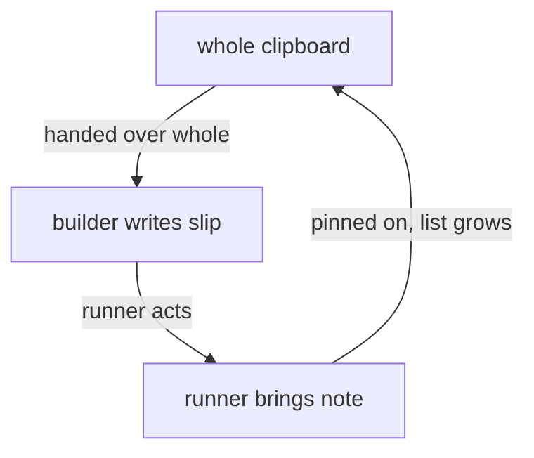

**See it yourself (2 minutes).** Open one finished Kilo task and count its messages. Check that each tool call added one slip and one note.

**In SubhForge:** the transcript lives only inside a run: "No vector database or long chat transcript is needed for normal reconstruction" (Architecture §21).

**Chain so far:** remembers nothing → output varies → works through a loop → errors compound → truth written outside → one home per fact → kinds of truth kept apart → context is a budget → work cut to fit → claims need evidence → code checks what code can prove → evidence expires → the human decides → change is reconciled → safe to repeat → a trace is kept → one argument → the transcript is the loop's state

**Check yourself:** The agent read a config file on turn 3. Why can it still use the value on turn 9, and what would make it lose it?

*Tomorrow:* he stops writing slips and goes home. Does that mean the room is built?

*Source:* [Google, "Agents" whitepaper, p. 8](https://github.com/subhadlearner/my-learning-with-claude/blob/main/HarnessEngineering/Resources/22365_19_Agents_v8.pdf): for a bare model, "Unless explicitly implemented for the model, there is no management of session history or continuous context."

### Day 19 · 27 Oct: How does the loop know when to stop?

**Day 19: How does the loop know when to stop?**

*Yesterday:* Turn 3's note is still in the transcript sent on turn 9; remove it and, for the model, the file was never read.

Late afternoon, the builder hands back the clipboard with no new slip on it and goes home. Nobody told him to stop. Who decided, and what does his leaving tell you?

**Step 1. What does the program do with each reply?** If the reply asks for an action, the program runs it, appends the result as a note, and calls the model again (Day 18).
*Each slip goes to the runner; the note comes back and is pinned on.*

**Step 2. What if the reply asks for nothing?** Then there is nothing to run and no note to send back. The loop has no next step, so it ends. This is the ordinary stop.
*He hands back the clipboard with no slip, and the runner has no errand.*

**Step 3. So who decided to stop?** The model, inside its reply. The program did not look at the work; it simply found no request.
*The site did not close; he chose to put down his pen.*

**Step 4. How sure is that choice?** It is text from the same dice process as any other reply (Day 2). A reply saying "all done" can come out whether the work is done or not.
*He goes home as cheerfully after a half-built wall as after a finished one.*

**Step 5. What, then, does the stop tell you?** Three statements are in play: "the turn ended", "the task is finished", "the work is right". The stop proves only the first, and offers the second as a claim (Day 10).
*His leaving tells you he stopped, not that the room is built, nor built well.*

**Now it's obvious.** The ordinary stop is a reply that asks for no action: the model chose to stop. That is a claim about the task, not evidence that it is done.

**Picture.**

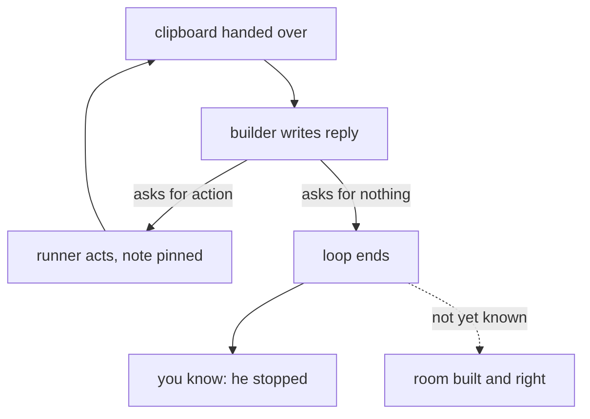

**See it yourself (2 minutes).** Take the last message of a finished Kilo task. What in the record, other than that message, shows the work is done?

**In SubhForge:** the Spec loop does not end where the builder stops: "READY Spec → Implement → focused tests → Verify → Review → Complete" (PRD FR-010).

**Chain so far:** remembers nothing → output varies → works through a loop → errors compound → truth written outside → one home per fact → kinds of truth kept apart → context is a budget → work cut to fit → claims need evidence → code checks what code can prove → evidence expires → the human decides → change is reconciled → safe to repeat → a trace is kept → one argument → the transcript is the loop's state → stopping is the model's claim

**Check yourself:** The loop ended because the model sent a reply with no tool request. What do you know?

*Tomorrow:* what if he never puts down his pen, and keeps writing slips forever?

*Source:* [Agentway Harness Books, book 1: Claude Code, p. 32](https://github.com/subhadlearner/my-learning-with-claude/blob/main/HarnessEngineering/Resources/book1-claude-code-en.pdf): "In one session, 'this turn ended' does not equal 'task completed,' and does not equal 'system succeeded.'"

### Day 20 · 28 Oct: What if he never stops writing slips?

**Day 20: What if he never stops writing slips?**

*Yesterday:* You know only that the model chose to stop asking for actions; whether the task is finished, and right, is still a claim until something checks it.

Yesterday the builder put down his pen. Today he doesn't: slip after slip, and the clipboard keeps getting heavier. Who ends this, and on what count?

**Step 1. Is he certain to stop on his own?** No. The ordinary stop happens only when a reply asks for nothing (Day 19), and that reply comes from the dice (Day 2). A confused model can always ask for one more action.
*Nothing in his nature makes him put the pen down.*

**Step 2. Does each extra turn cost the same?** No. Every turn resends the whole transcript, which grows by a slip and a note each time (Day 18).
*Each morning the clipboard he carries is thicker than yesterday's.*

**Step 3. So who must end it?** The program, holding a limit that fires whatever the reply says. A rule in the instructions is just more text the dice may ignore.
*The office, not the builder, decides when work stops.*

**Step 4. Limit on what: the number of turns?** Turns are a stand-in: forty tiny turns can be cheap; five that each read a huge file can be ruinous. What actually runs out is tokens (the chunks of text the model reads and writes, which you pay for), time and money.
*The office doesn't count his trips to the wall; it counts bricks, hours and wages.*

**Step 5. When is it checked?** Before each call, so the call that would overspend never goes out.
*Before the runner sets off, the office checks what is left in the allowance.*

**Now it's obvious.** Every loop needs a limit held by the program that the model cannot override. The honest limit is on what the run spends (tokens, time, money), not on how many turns it takes.

**Picture.**

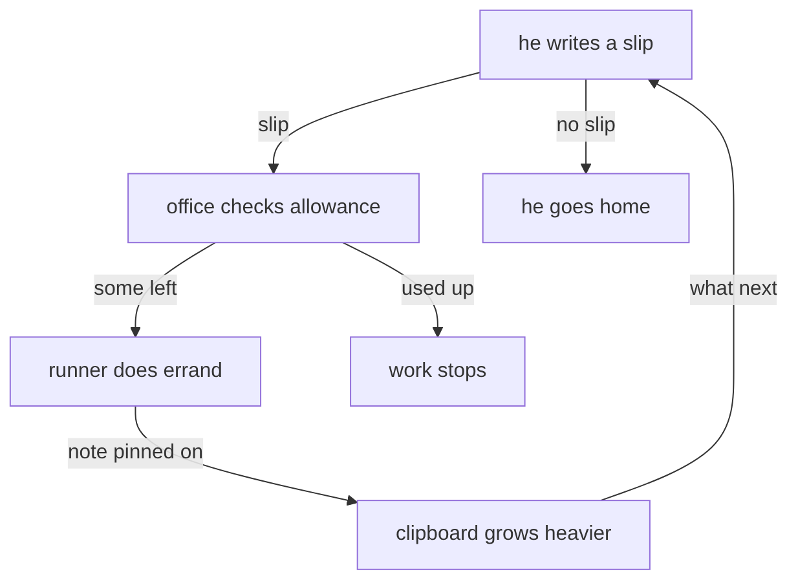

**See it yourself (2 minutes).** A run starts at 10k tokens and each turn adds 2k. What does turn 30 send, and what do thirty turns send in total?

**In SubhForge:** limits are checked before dispatch, and "An absent limit stops preflight; it is not read as unlimited" (Architecture §22).

**Chain so far:** remembers nothing → output varies → works through a loop → errors compound → truth written outside → one home per fact → kinds of truth kept apart → context is a budget → work cut to fit → claims need evidence → code checks what code can prove → evidence expires → the human decides → change is reconciled → safe to repeat → a trace is kept → one argument → the transcript is the loop's state → stopping is the model's claim → the loop is bounded from outside

**Check yourself:** Why can stopping not be left to the model, even a very good one?

*Tomorrow:* how do you notice he is going round in circles long before the allowance runs out?

*Source:* [Harness Engineering: Anatomy, Architecture, and Evolution of Coding Agents, p. 39](https://github.com/subhadlearner/my-learning-with-claude/blob/main/HarnessEngineering/Resources/Harness%20Engineering%20Anatomy%20Architecture%20%20and%20Evolution%20of%20Coding%20Agents.pdf): "Mini-SWE-Agent implements only resource limits as safety mechanisms—step_limit, cost_limit, and … a wall-clock limit".

